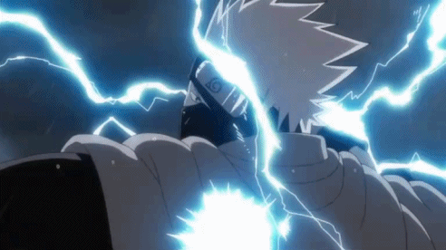
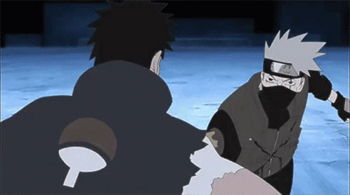
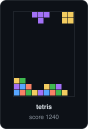
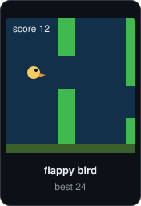

  

  
  

  

### 🚀 About Me

Technology enthusiast, computer science student, currently debugging life with no stack trace available. Powered by curiosity, caffeine, a pretty bad sleeping schedule, and way too many browser tabs.

🔭 &nbsp;Always on the go with a new project  
👯 &nbsp;Open to coding team-ups and tech brainstorming  
🤔 &nbsp;I say its a quick fix and boom , lose my entire weekend  
💬 &nbsp;Ask me about **C programming, my CS journey, Github, and beginner coding projects**  
😄 &nbsp;Pronouns: **he/him**

### 🛠️ Tech Stack

  
  
  
  

### 🔗 Connect With Me

  
  

### 📊 GitHub Stats

  
  

### 📈 Contribution Graph

  

### 🐍 Contribution Snake

  <picture>
    <source media="(prefers-color-scheme: dark)" srcset="https://raw.githubusercontent.com/User219-219/User219-219/output/github-snake-dark.svg" />
    <source media="(prefers-color-scheme: light)" srcset="https://raw.githubusercontent.com/User219-219/User219-219/output/github-snake.svg" />
    
  </picture>

### 🎮 Take a Break

  
  &nbsp;&nbsp;
  

### 💭 Thoughts

  <em>"Computer programs are powerful bombs and what you feed them can affect you in a powerful way."</em>  
  <em>"Now I have become death, the destroyer of worlds."</em>

<b><i>DERRICK_PRAISE</i></b>

---

<i>⭐️ From <a href="https://github.com/User219-219">User219-219</a></i>

